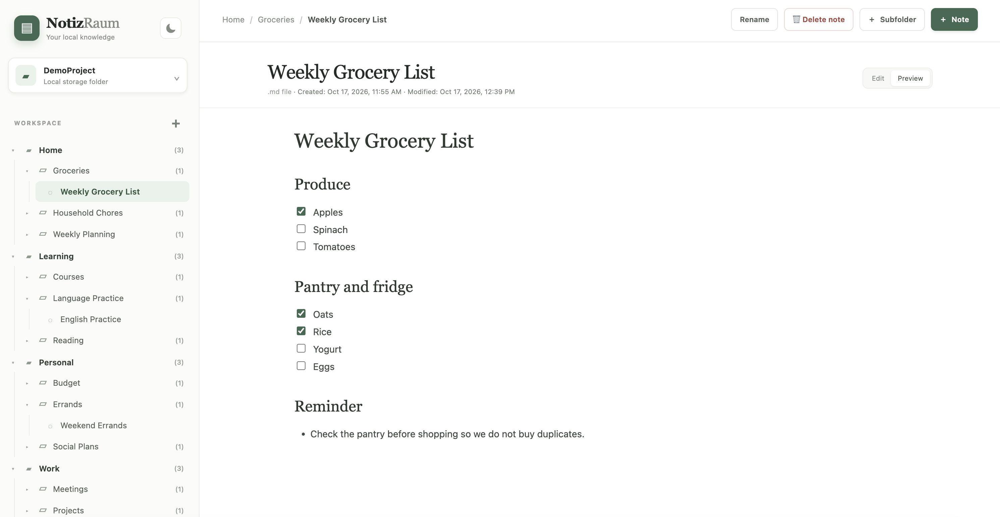

  
  <h1 style="font-family: Georgia, 'Times New Roman', serif;">NotizRaum</h1>
  
<b><i>NotizRaum</i></b> (German for “NoteSpace”) is a calm, private, feature-rich note-taking app for everyday notes, focused on the essentials. Built with just HTML, JavaScript, and CSS, it requires no database and stores notes as regular Markdown files on your device. It was created out of frustration with existing note-taking apps, which are often complex, difficult to use, or simply not the right fit.

  

---

## A little space for everything

- **Organize your workspace** with projects, nested folders, and Markdown notes.
- **Keep things in order** by dragging notes and folders between folders, or rearranging projects.
- **Write in Markdown** and switch between editing and a live preview with headings, lists, tables, links, images, code, and quotes.
- **Add images** by pasting them directly into a note.
- **Let notes save automatically** and see when they were created or last updated.
- **Undo with care:** deleted items go to the workspace trash, where you can review them before emptying it.
- **Make it yours** with light and dark themes. NotizRaum can remember your last workspace and project.
- **Add your language:** English and German are included. Add more languages by translating `languages/default.js`.

## Get started

No installation is required. Just download NotizRaum and open `index.html` in your browser, click **Connect Folder** and choose the folder where you want to store your notes (could also be a cloud storage if you want to sync). No server is required.

> **Browser support:** NotizRaum currently supports only Google Chrome and Microsoft Edge browsers. Firefox and Safari are not supported because the app requires the File System Access API.

Use the `DemoProject/` demo folder to try out the app.
